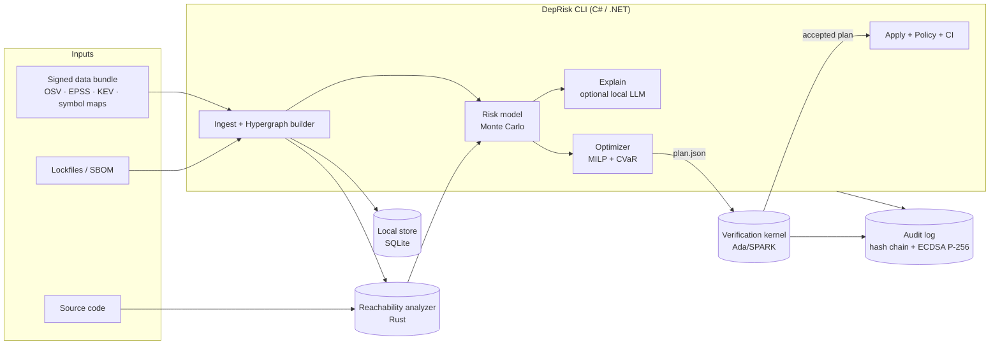

<div align="center">


# DepRisk

**Stop triaging CVEs by CVSS score. Start fixing the ones that can actually hurt you, with a plan you can prove is safe.**

A command-line framework for **risk-aware, uncertainty-driven prioritization and safe remediation of software dependency vulnerabilities**, built on reachability analysis, dependency hypergraphs, and decision optimization, with a **formally verified plan checker** and a **tamper-evident audit log**.


</div>

> **Honesty note.** This README describes the design and target behavior of DepRisk. Every feature is tagged with its status in [Feature status](#feature-status). Benchmark numbers are never hand-written: they are produced by `deprisk bench` and committed under `benchmarks/results/`. If a number is not there, it does not exist yet.

---

## Table of contents

1. [The problem](#the-problem)
2. [What DepRisk does differently](#what-deprisk-does-differently)
3. [Quick start](#quick-start)
4. [Installation](#installation)
5. [Usage](#usage)
6. [How it works (the method)](#how-it-works-the-method)
7. [Architecture](#architecture)
8. [Formal verification](#formal-verification)
9. [Tamper-evident audit log](#tamper-evident-audit-log)
10. [Air-gapped operation](#air-gapped-operation)
11. [CI/CD integration](#cicd-integration)
12. [Configuration](#configuration)
13. [Evaluation and reproducibility](#evaluation-and-reproducibility)
14. [Threat model and limitations](#threat-model-and-limitations)
15. [Feature status](#feature-status)
16. [Roadmap](#roadmap)
17. [For teams and companies](#for-teams-and-companies)
18. [Contributing](#contributing)
19. [Research and citation](#research-and-citation)
20. [License](#license)

---

## The problem

A typical mid-size project has hundreds of transitive dependencies. A scanner reports dozens or hundreds of advisories. Teams then do one of three things:

1. **Fix everything by CVSS order.** CVSS measures severity in a generic scenario, not *your* exposure. Most "critical" findings sit in code paths your application never calls.
2. **Ignore the noise.** Alert fatigue wins and real risk hides in the pile.
3. **Bump everything to latest.** This breaks builds, burns engineering time, and still gives no guarantee the result is consistent.

Three questions are left unanswered by mainstream tooling:

| Question | Why it is hard |
|---|---|
| *Is the vulnerable code reachable from my application?* | Needs call-graph analysis, not just version matching. |
| *How sure are we, and what is the downside if we are wrong?* | Risk is a distribution, not a single number. |
| *Given limited time, which set of upgrades is best, and is that set even consistent?* | Packages constrain each other in groups (hyperedges), and the best set is an optimization problem. |

DepRisk answers all three, from the terminal, offline if you need it.

## What DepRisk does differently

- **Reachability-aware.** Maps each advisory to vulnerable symbols and checks whether your code can reach them. Findings are labeled `reachable`, `possibly-reachable`, `unreachable`, or `unknown`, never silently dropped.
- **Uncertainty-driven.** Risk is modeled as a probability distribution (not a point score). Plans can optimize expected risk *and* tail risk (CVaR).
- **Decision optimization.** Remediation is solved as a constrained optimization problem: minimize residual risk under an effort budget and compatibility constraints.
- **Hypergraph model.** Multi-package constraints (for example, three packages that must move together) are first-class hyperedges, not flattened into pairwise edges.
- **Verified plans.** A small, formally proven kernel (Ada/SPARK) independently checks every plan. The optimizer is *untrusted*; the checker is *proven*.
- **Auditable.** Every decision is recorded in a hash-chained, signed log you can verify offline.
- **Air-gapped ready.** Signed offline data bundles; zero network calls by default during analysis.
- **Interoperable.** Reads CycloneDX/SPDX SBOMs and lockfiles; emits SARIF, JSON, and OpenVEX.
- **Deterministic.** Same inputs, same seed, same plan. LLM explanations are optional, local-model capable, and never influence the plan.

## Quick start

```bash
# 1. Install (see Installation for other options)
dotnet tool install -g DepRisk.Cli

# 2. Inside your project
cd my-project
dotnet restore                    # scan reads the restore output (obj/project.assets.json)
deprisk init                      # optional: start a signed audit log (.deprisk/)

# 3. Analyze
deprisk scan                      # read the resolved dependency graph (offline)
deprisk match --advisories NuGet.zip   # known vulnerabilities, from OSV data you supply (offline)
deprisk rank --advisories NuGet.zip --epss epss_scores-current.csv.gz --kev known_exploited_vulnerabilities.json   # baseline priority order
deprisk reach                     # reachability analysis against your source
deprisk rank                      # risk distribution per finding

# 4. Get a provably consistent fix plan within 6 engineer-hours
deprisk plan --budget 6h --out plan.json
deprisk verify plan.json          # formally checked by the SPARK kernel

# 5. Preview or apply
deprisk apply plan.json --dry-run
deprisk apply plan.json --branch deprisk/fix-2026-10
```

Illustrative output (format only; numbers are made up for this example):

```text
$ deprisk rank --top 5

 #  ADVISORY            PACKAGE              REACH       P(exploit)  RISK p50  RISK p95
 1  GHSA-xxxx-xxxx      lib-a 2.3.1          reachable   0.41        8.7       12.4
 2  CVE-2025-XXXXX      lib-b 1.9.0          possibly    0.18        3.1        9.8
 3  CVE-2024-XXXXX      lib-c 4.0.2          reachable   0.02        1.4        3.3
 4  CVE-2025-XXXXX      lib-d 0.8.7          unreachable 0.60        0.0        0.9
 5  GHSA-xxxx-xxxx      lib-e 5.1.0          unknown     0.07        0.8        4.1

 38 findings total | 6 reachable | 9 possibly | 17 unreachable | 6 unknown
```

## Installation

> **Pre-alpha:** the install options below describe the intended distribution. Each one becomes valid when the corresponding release ships (see [Feature status](#feature-status) and [Roadmap](#roadmap)). Until then, build from source.

DepRisk ships as one CLI plus two companion binaries (reachability analyzer and verification kernel). The installer wires them together.

### Option A: .NET global tool

```bash
dotnet tool install -g DepRisk.Cli
deprisk doctor        # checks that analyzer + kernel binaries are present
```

### Option B: prebuilt binaries

Download the archive for your OS from the Releases page. Archives include checksums and signatures.

```bash
sha256sum -c SHA256SUMS
tar -xzf deprisk-<version>-linux-x64.tar.gz
sudo install deprisk /usr/local/bin/
```

### Option C: Docker

```bash
docker run --rm -v "$PWD":/work -w /work ghcr.io/codeoops-dev/deprisk:latest scan
```

### Option D: from source

Requirements: .NET SDK, Rust toolchain, GNAT with GNATprove (only needed to rebuild proofs).

```bash
git clone https://github.com/codeoops-dev/deprisk.git
cd deprisk
make build            # builds CLI, Rust analyzer, SPARK kernel
make test
make prove            # re-runs the formal proofs (GNATprove)
```

## Usage

All commands accept `--format table|json|sarif|openvex`, `--config <path>`, and `--offline`. Exit codes are stable and documented below.

| Command | Purpose |
|---|---|
| `deprisk init [path]` | Create `.deprisk/` with a signing key and start the signed audit log. Never overwrites anything. |
| `deprisk scan [path]` | Parse lockfiles/SBOMs, build the dependency hypergraph, match advisories. |
| `deprisk match [path]` | Match the resolved dependencies against local OSV advisories: `--advisories <dir\|.zip\|.json>` (required), `--format table\|json`, `--out`, `--strict`. Offline; matching is by version only. |
| `deprisk rank [path]` | Like `match`, ordered by the baseline method: CISA KEV, then EPSS, then CVSS v3 base score. `--advisories <...>` (required), `--epss <csv[.gz]>`, `--kev <json>`, `--format table\|json`, `--out`, `--strict`. Offline; the reference (B2) for the later model. |
| `deprisk graph` | Inspect or export the hypergraph (`--export dot\|json`). |
| `deprisk reach` | Run reachability analysis from your entrypoints to vulnerable symbols. |
| `deprisk rank` | Compute risk distributions and rank findings. |
| `deprisk plan` | Compute an optimal remediation plan under budget and constraints. |
| `deprisk verify <plan>` | Check a plan with the formally verified kernel. |
| `deprisk apply <plan>` | Apply a verified plan (manifest edits, branch, optional PR). |
| `deprisk explain <id>` | Explain why a finding ranks where it does (evidence, call path, uncertainty). |
| `deprisk vex` | Export OpenVEX statements for findings proven or judged unreachable. |
| `deprisk audit verify [path]` | Verify the integrity of the audit log (`--pubkey <file>`, `--head <hash>`). |
| `deprisk bundle create\|import\|verify` | Build or load signed offline data bundles. |
| `deprisk bench` | Run the reproducible benchmark suite. |
| `deprisk ci` | One-shot CI mode with policy gates and SARIF output. |
| `deprisk doctor` | Diagnose installation. |

### Examples

```bash
# Why is this finding ranked first? Shows call path and the distribution behind the score.
deprisk explain GHSA-xxxx-xxxx

# Be risk-averse: weight the worst 5% of outcomes
deprisk plan --budget 8h --risk-aversion 0.4 --cvar-alpha 0.95

# Forbid major-version bumps for specific packages
deprisk plan --budget 4h --pin lib-x --no-major lib-y

# Export "not affected" statements to share with customers
deprisk vex --status not_affected --out vex.json

# Reproducible run
deprisk plan --seed 42 --solver cbc --out plan.json
```

### Exit codes

| Code | Meaning |
|---|---|
| 0 | Success, policy satisfied |
| 1 | Policy gate failed (for example, reachable finding above threshold) |
| 2 | Plan verification failed |
| 3 | Audit log integrity failure |
| 4 | Input or configuration error |
| 5 | Internal error |

## How it works (the method)

### 1. Dependency hypergraph

Ordinary dependency graphs use pairwise edges: *A depends on B*. Real constraints often involve several packages at once (a framework family that must share a version line, a plugin set that must match a host). DepRisk models these as hyperedges.

Let `P` be the set of packages and `V_p` the candidate versions of package `p`. A configuration picks exactly one version per package. A hyperedge `e = (S_e, C_e)` has a scope `S_e ⊆ P` and a set of allowed joint assignments `C_e`. A configuration is **consistent** iff every hyperedge's scope assignment lies in `C_e`.

### 2. Reachability

For each advisory, DepRisk resolves a **symbol set** (functions, methods, or modules that carry the flaw) from, in priority order:

1. explicit symbol data in the advisory (for example OSV ecosystem-specific fields),
2. a curated symbol map shipped in the data bundle,
3. symbols **mined from the upstream fix commit** (functions changed by the patch).

A Rust analyzer builds a conservative call graph from your declared entrypoints and checks whether any path reaches the symbol set. Dynamic features (reflection, dynamic dispatch, eval-like constructs) add *possible* edges marked as such. Output is one of:

`reachable` (path found) · `possibly-reachable` (path needs dynamic edges) · `unreachable` (no path in the over-approximated graph) · `unknown` (no symbol data, or unsupported construct)

`unknown` is deliberately **not** treated as safe.

### 3. Risk under uncertainty

For finding `v`, risk is the product of three uncertain quantities:

```
R_v = Reach_v × Exploit_v × Impact_v
```

- `Reach_v ~ Beta(α, β)` where parameters depend on the reachability label and analyzer precision, calibrated on the benchmark.
- `Exploit_v` is derived from EPSS and KEV membership, modeled as a calibrated Beta to represent forecast uncertainty.
- `Impact_v` comes from your asset-criticality policy (`deprisk.toml`), with optional ranges.

DepRisk samples these (seeded Monte Carlo) and reports quantiles (p50, p95) rather than a single number. This is what lets a "probably fine but catastrophic if wrong" finding outrank a "probably fine and mild" one.

### 4. Remediation as optimization

Decision variables: `x_{p,v} ∈ {0,1}` (package `p` ends at version `v`).

```
minimize     E[ Σ_v (1 − fixed_v(x)) · R_v ]  +  λ · CVaR_α( Σ_v (1 − fixed_v(x)) · R_v )

subject to   Σ_v x_{p,v} = 1                       for every package p     (one version each)
             hyperedge constraints C_e              for every hyperedge e   (consistency)
             Σ_{p,v} cost(p, v0→v) · x_{p,v} ≤ B                            (effort budget)
             policy constraints (pins, no-major, license allow-list)
```

- `cost` estimates effort from semver distance and, when API-diff data is available, from **whether your code uses the changed API** (a breaking change you never touch is cheap).
- CVaR is linearized with the Rockafellar–Uryasev formulation over Monte Carlo scenarios, so the whole problem is a mixed-integer linear program solvable with open-source solvers (default: CBC/HiGHS).
- Setting `--risk-aversion 0` recovers pure expected-risk minimization.

### 5. Safe application

`apply` edits manifests/lockfiles only after the kernel accepts the plan, creates a branch, and (optionally) runs your configured build and test command in a sandbox before proposing a PR. Failed validation rolls back and is logged.

## Architecture



**Design decisions**

| Decision | Rationale |
|---|---|
| CLI-first, no server | Zero setup, easy to script, easy to run in CI and air-gapped hosts. |
| C# core | Fast to evolve; strong typing for the model and optimizer glue. |
| Rust analyzer | Performance and memory safety for parsing untrusted source at scale. |
| SPARK kernel | Small trusted base with machine-checked proofs; keeps the optimizer out of the trust boundary. |
| SQLite local store | No database to install. A PostgreSQL backend for team/server mode is on the [roadmap](#roadmap) and the storage layer is behind an interface. |
| No code execution of scanned projects | Static analysis only. Build/test execution happens only in `apply --validate`, in an explicit sandbox. |

**Repository layout**

```text
deprisk/
├── src/
│   ├── DepRisk.Cli/            # commands, config, output formats
│   ├── DepRisk.Core/           # hypergraph, risk model, optimizer, policy
│   ├── DepRisk.Audit/          # hash-chained signed log
│   └── DepRisk.Data/           # bundle format, advisory ingestion
├── analyzers/
│   └── reach/                  # Rust reachability analyzer
├── kernel/
│   └── spark/                  # Ada/SPARK plan checker + proofs
├── benchmarks/
│   ├── datasets/               # pinned repo snapshots + ground truth manifests
│   └── results/                # generated by `deprisk bench`
├── docs/
│   ├── adr/                    # architecture decision records
│   ├── method.md               # full mathematical specification
│   └── threat-model.md
├── paper/                      # preprint sources and reproducibility artifacts
├── tests/
├── deprisk.toml.example
└── Makefile
```

## Formal verification

The optimizer (MILP + sampling) is complex and floating-point heavy, so it is **not** trusted. Instead, `deprisk verify` runs a small kernel written in **Ada/SPARK** and proven with GNATprove.

The kernel takes the hypergraph, the current configuration, the plan, and the budget as input. If it returns `ACCEPT`, the following are proven properties of the code:

| Property | Meaning |
|---|---|
| **P1: Uniqueness** | Every package ends with exactly one version. |
| **P2: Consistency** | Every hyperedge constraint is satisfied by the resulting configuration. |
| **P3: Budget** | Total plan cost does not exceed the budget. |
| **P4: Policy** | Pins, no-major rules, and allow-lists are respected. |
| **P5: Fix claims** | Every advisory the plan claims to fix is actually outside its affected range after the plan. |
| **P6: Absence of runtime errors** | No overflow, out-of-bounds, or uninitialized reads (SPARK AoRTE). |

Design choices that keep the proofs tractable: scaled-integer arithmetic (no floating point in the kernel), bounded collections, and a deliberately small input format. Proof status is reproducible with `make prove`; the CI pipeline fails if any verification condition is unproven.

> What is *not* proven: that the plan is *optimal* (that is the optimizer's job and is evaluated empirically), or that reachability labels are correct (see [limitations](#threat-model-and-limitations)).

## Tamper-evident audit log

Every command that reads sensitive state or changes something writes an entry:

| Field | Content |
|---|---|
| `seq`, `timestamp` | Monotonic sequence number and UTC time |
| `actor`, `host`, `cwd` | OS user, machine, working directory |
| `git_commit` | Repository state at the time |
| `command`, `args` | What was run |
| `inputs_digest`, `outputs_digest` | SHA-256 over inputs and results |
| `changes` | Structured diff, `from → to` (for example `lib-a 2.3.1 → 2.5.0`) |
| `prev_hash` | Hash of the previous entry |
| `signature` | ECDSA (P-256, SHA-256) signature over the entry, Base64 |

Entries form a hash chain, and the format is specified precisely in [`docs/audit-log.md`](docs/audit-log.md) (RFC 8785 canonical JSON), so anyone can re-implement verification. Anyone with the public key can run:

```bash
deprisk audit verify --pubkey auditor.pub
```

Editing, deleting, inserting, or reordering entries is detected. A log alone cannot show that entries were cut off its **end**, so pin the head: store the `head:` hash that `audit verify` prints somewhere you trust (a ticket, a signed release, another machine) and check it later with `deprisk audit verify --head <hash>`. Keys are generated locally by `init`; the private key stays in `.deprisk/audit.key` (owner-only permissions where the OS supports it, excluded from Git by `.deprisk/.gitignore`). Merkle checkpoints and a transparency-log style workflow are on the roadmap.

## Air-gapped operation

DepRisk makes **no network calls** during `scan`, `reach`, `rank`, `plan`, `verify`, or `audit`. Fresh data enters through signed bundles:

```bash
# On a connected machine
deprisk bundle create --sources osv,epss,kev,symbols --out deprisk-bundle-2026-10-27.tar
deprisk bundle sign   deprisk-bundle-2026-10-27.tar --key release.key

# Transfer via approved media, then on the isolated machine
deprisk bundle verify deprisk-bundle-2026-10-27.tar --pubkey release.pub
deprisk bundle import deprisk-bundle-2026-10-27.tar
```

Bundles are versioned and timestamped; DepRisk warns when your data is older than the configured freshness window. No telemetry is collected, ever.

## CI/CD integration

```yaml
# .github/workflows/deprisk.yml
name: deprisk
on: [pull_request]
jobs:
  deprisk:
    runs-on: ubuntu-latest
    steps:
      - uses: actions/checkout@v4
      - run: dotnet tool install -g DepRisk.Cli
      - run: deprisk ci --format sarif --out deprisk.sarif --fail-on reachable:p95>=7
      - uses: github/codeql-action/upload-sarif@v3
        with:
          sarif_file: deprisk.sarif
```

`deprisk ci` is non-interactive, deterministic, honors policy gates, and returns the documented exit codes. A pre-built GitHub Action wrapper is on the roadmap.

## Configuration

`deprisk.toml`:

```toml
[project]
name = "my-service"
entrypoints = ["src/Api/Program.cs", "src/Worker/Main.cs"]
ecosystems = ["nuget", "npm"]

[assets]
# Impact tiers feed the risk model (ranges express uncertainty)
default_impact = [3.0, 6.0]
[assets.overrides]
"src/Payments/**" = [8.0, 10.0]

[risk]
samples = 5000
seed = 42
cvar_alpha = 0.95
risk_aversion = 0.3

[plan]
budget = "6h"
solver = "highs"
no_major = ["lib-y"]
pin = ["lib-x"]

[policy]
fail_on = "reachable:p95>=7"
license_allow = ["MIT", "Apache-2.0", "BSD-3-Clause"]
data_freshness_days = 14

[apply]
validate_cmd = "dotnet test"
sandbox = true

[audit]
key = ".deprisk/audit.key"
```

## Evaluation and reproducibility

Claims should be falsifiable. DepRisk ships its own evaluation harness.

**Baselines compared**

| Baseline | Description |
|---|---|
| B1 | CVSS-only ordering |
| B2 | CVSS + EPSS/KEV |
| B3 | Reachable-only filtering (no uncertainty, no optimization) |
| B4 | "Upgrade everything to latest" |
| **DepRisk** | Full pipeline |

**Metrics**

| Metric | What it tells you |
|---|---|
| Residual expected risk vs. effort (Pareto curve) | Quality of prioritization under a budget |
| Alert reduction with no missed known-exploited findings | Noise removed without losing real risk |
| Reachability precision/recall on labeled cases | Analyzer quality |
| Post-plan build/test pass rate | Whether "safe" remediation is actually safe |
| Plan verification time | Practical cost of formal checking |
| Calibration of risk quantiles | Whether stated uncertainty is honest |

**Reproduce**

```bash
make bench                      # full suite, pinned datasets, fixed seeds
deprisk bench --suite quick     # smoke test, minutes
```

Datasets are pinned by commit hash with ground-truth manifests (known-exploited advisories, historical fix commits). Results land in `benchmarks/results/` as machine-readable files plus generated plots. **No result is reported unless it can be regenerated by these commands.**

> Results: *not yet generated.* This section will be filled from `benchmarks/results/` when the first full run completes.

## Threat model and limitations

DepRisk analyzes untrusted code and handles security-relevant decisions, so its own limits are stated plainly.

**Security posture**

- Static analysis only; scanned projects are never executed by `scan`/`reach`/`rank`/`plan`.
- Parsers run in the memory-safe analyzer process; `apply --validate` runs project commands only inside a sandbox you configure.
- Data bundles are signature-verified before import; unsigned bundles are rejected unless `--insecure-allow-unsigned` is passed (and this is logged).
- No telemetry, no phone-home.
- See [`docs/threat-model.md`](docs/threat-model.md) for assets, adversaries, and mitigations.

**Known limitations**

| Limitation | Effect | Handling |
|---|---|---|
| Reflection, dynamic loading, eval-like code | Call graph may miss or over-approximate paths | Marked `possibly-reachable`/`unknown`, never silently "safe" |
| Missing symbol data for an advisory | Cannot decide reachability | Labeled `unknown`; counted as risk |
| EPSS/KEV are forecasts and incomplete | Exploit probability is uncertain | Modeled as distributions |
| Effort/cost estimates are heuristic | Plans may over/under-budget | Budget is a model input; calibrate with `deprisk bench` |
| Ecosystem coverage | Initial release covers a subset | See [Feature status](#feature-status) |
| Kernel proves consistency, not optimality | A verified plan may be suboptimal | Optimality evaluated empirically |

Found a security issue in DepRisk itself? See [`SECURITY.md`](SECURITY.md) for private disclosure.

## Feature status

Legend: ✅ implemented · 🚧 in progress · 🗺️ planned

| Area | Feature | Status |
|---|---|---|
| Ingest | NuGet restore graph (`project.assets.json`) via `deprisk scan` | ✅ |
| Ingest | NuGet lockfiles (`packages.lock.json`) | 🗺️ |
| Match | Advisory matching: OSV records (dir, .zip, .json), NuGet version ranges, offline, via `deprisk match` | ✅ |
| Rank | Baseline ranking (KEV, EPSS, CVSS v3 base score; no reachability or uncertainty) via `deprisk rank` | ✅ |
| Rank | CVSS v4.0 scoring | 🗺️ |
| Ingest | npm lockfiles | 🗺️ |
| Ingest | CycloneDX / SPDX SBOM | 🗺️ |
| Model | Dependency hypergraph | 🗺️ |
| Analysis | Reachability: C# | 🗺️ |
| Analysis | Reachability: JS/TS | 🗺️ |
| Analysis | Symbol mining from fix commits | 🗺️ |
| Risk | Monte Carlo risk distributions | 🗺️ |
| Plan | MILP optimizer with CVaR | 🗺️ |
| Verify | SPARK kernel (P1–P6) | 🗺️ |
| Audit | Hash-chained signed log, `init`, `audit verify` (head pinning included) | ✅ |
| Audit | Merkle checkpoints and external anchoring | 🗺️ |
| Offline | Signed bundles | 🗺️ |
| Output | SARIF / JSON / OpenVEX | 🗺️ |
| CI | `deprisk ci` + policy gates | 🗺️ |
| Explain | Deterministic evidence report | 🗺️ |
| Explain | Optional local-LLM narrative | 🗺️ |

*(Update this table as features land; it is the source of truth for what works today.)*

## Roadmap

- **v0.1** CLI skeleton, NuGet + npm ingest, hypergraph, advisory matching, risk ranking (CVSS+EPSS+KEV baseline), audit log.
- **v0.2** Reachability (C#, JS/TS), uncertainty model, `explain`, OpenVEX export.
- **v0.3** Optimizer (MILP + CVaR), plan format, `plan`/`apply --dry-run`.
- **v0.4** SPARK kernel and proofs, `verify`, benchmark harness and first published results.
- **v0.5** Signed offline bundles, CI mode, SARIF, GitHub Action.
- **v1.0** Stable plan/audit formats, documented exit codes and schemas, preprint.
- **Later** More ecosystems (Cargo, PyPI, Maven, Go), PostgreSQL team mode, transparency-log checkpoints, richer API-diff-based cost model.

## For teams and companies

If you evaluate tooling for a security or platform team, here is what to check:

| You care about | What to look at |
|---|---|
| Noise reduction | `deprisk bench` alert-reduction metric and `explain` output for suppressed findings |
| Trust in automation | The proven kernel and its published properties (P1–P6) |
| Compliance and audit | Signed audit log, OpenVEX export, SARIF in your existing pipeline |
| Restricted networks | Air-gapped workflow and signed bundles |
| Data privacy | No telemetry, no source code leaves the machine |
| Adoption cost | Single CLI, no server or database to run, standard exit codes |

**Pilot it in a day:** run `deprisk scan && deprisk reach && deprisk rank` on one service, compare the top 10 against your current process, and open an issue with what it got right or wrong. Negative results are valuable and will be credited.

## Contributing

Contributions are welcome, especially:

- ecosystem parsers and reachability support for new languages,
- curated vulnerable-symbol maps,
- benchmark datasets with ground truth,
- proof engineering and review of the SPARK kernel,
- real-world false-positive/false-negative reports.

See [`CONTRIBUTING.md`](CONTRIBUTING.md) and [`CODE_OF_CONDUCT.md`](CODE_OF_CONDUCT.md). Please open an issue before large changes. Architecture decisions are recorded in [`docs/adr/`](docs/adr/).

## Research and citation

DepRisk is developed alongside academic research on risk-aware, uncertainty-driven remediation of dependency vulnerabilities. Open research questions the project is designed to test:

1. Does modeling uncertainty (and tail risk) produce better remediation plans than point-score ranking at equal effort?
2. How much does hyperedge-aware consistency modeling reduce failed or inconsistent upgrades versus pairwise models?
3. How well do symbols mined from fix commits approximate curated vulnerable-function data for reachability?
4. What is the practical cost of verifying plans with a proven kernel?

If you use DepRisk in academic work, please cite it (see [`CITATION.cff`](CITATION.cff)). A preprint will be linked here when available.

**Author:** Jahed Kabiri, Tabriz, Iran. Issues and discussions on this repository are the best way to reach the project.

## License

Apache License 2.0. See [`LICENSE`](LICENSE).
